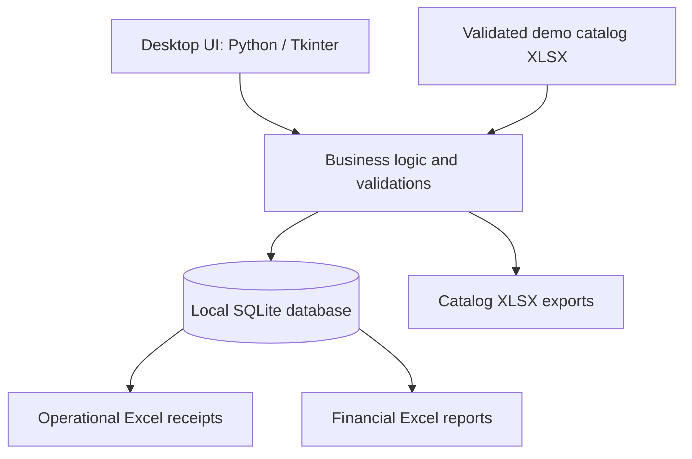

# Clinical Laboratory Management System

**Offline-first business automation · SQLite data management · Excel reporting**

A Python desktop application that demonstrates how operational workflows can be digitized in environments where **reliable internet access cannot be assumed**. It combines structured customer and laboratory study records, multi-item sales, local persistence, operational Excel receipts, and financial summaries in one application.

> **Public portfolio demonstration — synthetic data only.** This repository is an independently reimplemented, anonymized showcase of the core concepts and workflows behind a real professional project. It is **not** the company's original production application, a copy of its production database, or a clinical information system approved for actual patient care.

## 01 / Project background

This project originated from a real business automation challenge involving laboratory operations across multiple branches. Staff needed to register customers, capture laboratory studies and payments, consult historical records, and produce spreadsheets in specific formats for day-to-day work.

Two practical constraints shaped the solution:

1. **Unreliable connectivity.** Some locations experienced internet outages lasting hours or even days, making a cloud-dependent, always-online workflow unsuitable.
2. **Excel-dependent procedures.** Laboratory staff and administrative teams required information in familiar spreadsheet formats, so replacing Excel entirely was not an option.

The resulting approach was **offline-first**: use a local relational database for structured records and generate Excel documents for the teams who depend on them. This is a deliberate operational design decision, not a claim that separate branches are automatically synchronized.

The public demonstration follows that same philosophy using generic branding, synthetic examples, simplified settings, and a redesigned Tkinter interface. It does not disclose company-specific assets, identities, financial records, patient information, or credentials.

## 02 / What this project demonstrates

- **Process automation:** turns repetitive data entry, document preparation, and record consultation into reproducible workflows.
- **Relational data modeling:** separates customers, studies, branches, sales, and line items in SQLite.
- **Structured exports:** transforms stored records into operational Excel receipts and financial workbooks.
- **Data consistency:** captures unit prices and direct costs at the time of sale so historical calculations remain stable if catalog prices change later.
- **Offline operation:** runs locally after installation without cloud APIs or a live network connection.
- **Interoperability:** imports and exports customer and study catalogs using validated `.xlsx` files.

## 03 / Core features

| Module | Public-demo functionality |
| --- | --- |
| Customer management | Register, browse, and update synthetic customer records. |
| Study catalog | Manage laboratory study names, sample types, instructions, turnaround days, sale prices, and direct costs. |
| Sales | Create multi-study sales, calculate totals, register an initial payment, and issue unique local folios. |
| Operations | Record optional collection, fasting, urination, observations, and result-delivery details. |
| Excel receipts | Generate one worksheet per selected sale, including administrative details, study line items, and balances. |
| Financial reporting | Generate transaction-level and aggregated workbooks for revenue, estimated direct costs, estimated gross margin, payments, and outstanding balances. |
| Excel interchange | Export and import synthetic customer and study catalogs with basic format checks and non-destructive inserts. |
| Local authentication | Demonstration-only account with PBKDF2-HMAC-SHA256 password hashing. |

### Two Excel outputs, two business needs

**Operational receipts** support laboratory staff. From a chosen date range and optional branch filter, the app produces a workbook with a separate worksheet for each sale. Each worksheet summarizes the synthetic customer's information, requested studies, collection instructions, delivery notes, totals, and payments. These are **operational worksheets**, not diagnostic results or fiscal invoices.

**Financial reports** support administrative review. The app exports a detailed sales sheet and an aggregated summary containing sales count, recorded revenue, estimated direct costs, estimated gross margin, payments received at sale time, and outstanding balances. **Gross margin is not net profit**: the demonstration does not model indirect expenses, taxes, or other accounting adjustments.

## 04 / Architecture and data flow



The local database contains the following related tables:

| Entity | Purpose |
| --- | --- |
| `users` | Local demonstration login. |
| `branches` | Generic branch identifiers. |
| `customers` | Synthetic customer records. |
| `studies` | Study catalog and estimated direct costs. |
| `sales` | Transaction headers, folios, dates, payment, and operational notes. |
| `sale_items` | Quantity, unit price, and unit cost snapshots for each sale line. |

All writes take place locally. **There is no automatic cross-branch synchronization, cloud database, or conflict-resolution service in this repository.**

## 05 / Technology stack

| Layer | Technology |
| --- | --- |
| Desktop interface | Python, Tkinter / ttk |
| Persistence | SQLite (`sqlite3`) |
| Data modeling and validation | Python, SQL |
| Spreadsheet generation and import | openpyxl |
| Authentication example | `hashlib.pbkdf2_hmac`, `hmac` |
| Tests | Python `unittest` |

The public demo uses Python's standard library plus **openpyxl**. The original professional workflow inspired the project, but the demo intentionally uses a smaller and more reproducible dependency set.

## 06 / Installation (Windows)

**Requirements:** Python 3.11 or later, with Tkinter available.

```powershell
# 1. Clone the repository
git clone https://github.com/Slowpokeislife/clinical-lab-management-system.git
cd clinical-lab-management-system

# 2. Create and activate a local environment
py -m venv .venv
.\.venv\Scripts\Activate.ps1

# 3. Install the spreadsheet dependency
python -m pip install -r requirements.txt

# 4. Initialize an entirely synthetic local database
python scripts/init_demo.py --password "Your-Own-Demo-Password-123"

# 5. Run the application
python main.py
```

**Demo login:** username `demo`, password: the value supplied in step 4. Choose a password of at least ten characters; do not reuse an actual password.

After installation and database initialization, normal local operations do not need an internet connection. The database is created at `local_data/demo.sqlite3`, which is ignored by Git. Example records are generated locally rather than shipped as real customer data.

For a different platform, verify the availability of Tkinter before installing. The desktop interface was designed for a local graphical environment.

## 07 / Try these workflows

1. Sign in with the local demo account.
2. Browse synthetic customers and add a fictional customer.
3. Inspect the study catalog, including price and direct cost fields.
4. Register a sale with multiple studies and a partial payment.
5. Open the reporting screen; filter by date and, if relevant, branch.
6. Generate an **Excel receipt workbook** and review the per-sale worksheets.
7. Generate a **financial report workbook** and compare transaction details with summary metrics.
8. Export a customer or study catalog to Excel; test import only with invented records and the expected column schema.

### Automated checks

```powershell
python -m unittest discover -s tests -v
```

The supplied tests cover selected core behaviors; they do not constitute a complete security audit, end-to-end clinical validation, or cross-platform GUI certification.

## 08 / Repository structure

```text
clinical-lab-management-system/
├── main.py                 # Application entry point
├── manager.py              # Window and application shell
├── container.py            # Desktop navigation
├── core.py                 # SQLite schema and business rules
├── login.py                # Local demo login
├── clientes.py             # Customer screen
├── inventario.py           # Study catalog screen
├── ventas.py               # Sales screen
├── pedidos.py              # Excel generation functions
├── pedidos_ui.py           # Reports screen
├── proveedor.py            # Catalog Excel import and export
├── informacion.py          # Demo information screen
├── gui_utils.py            # Shared UI helpers
├── scripts/
│   └── init_demo.py        # Synthetic database initializer
├── tests/
│   └── test_core.py        # Core behavior tests
├── docs/
│   └── ARCHITECTURE.md     # Architecture notes
├── requirements.txt
└── README.md
```

## 09 / Privacy, ethics, and publication boundaries

The professional project that inspired this demonstration handled operational information belonging to a business and its customers. **None of that information belongs in a public code repository.**

For this showcase:

- All customer records, email addresses, branch names, and transaction examples are artificial.
- Company identity, logos, proprietary interface designs, addresses, tax identifiers, operational spreadsheets, and original databases are excluded.
- Production credentials, SMTP configurations, and email-sending features are not included.
- The interface is a new generic Tkinter demonstration; screenshots of the original operational system are not distributed.
- Database files and generated spreadsheets are excluded from version control.
- The demonstration is **not suitable for real patient records, clinical decision-making, fiscal invoicing, or production deployment**.

This distinction is intentional: the repository showcases technical skills and system design decisions without exposing confidential organizational material.

## 10 / Known limitations and future directions

The public demo intentionally has a narrower scope than the underlying professional work:

- No live synchronization between separate installations or branches.
- No production-grade authorization, audit logging, encryption-at-rest, or patient privacy controls.
- No email, messaging, clinical diagnosis, or laboratory-result validation.
- Excel catalog imports support simple validation and non-destructive insertion, not complex conflict reconciliation.
- Reporting covers captured payments and estimated gross margin; it is not a complete accounting or cash-flow system.

Possible future enhancements include stronger role-based access control, structured backup/restore, more extensive automated tests, import previews with row-level error reporting, and analytical dashboards using properly authorized synthetic datasets.

## 11 / What I learned

This project reinforced how software and data engineering decisions should follow actual working conditions. A technically sophisticated cloud stack is not always the appropriate choice when connectivity is unreliable. Likewise, Excel interoperability can be a core requirement rather than a temporary workaround.

From a data-oriented perspective, the work connects operational data capture, SQL schema design, repeatable exports, historical price integrity, and interpretable business metrics in a single workflow.

---

**Project focus:** Business Process Automation · Data Engineering · Relational Databases · Excel Reporting · Offline-first Desktop Applications

**Portfolio note:** This repository is a sanitized demonstration inspired by a real-world professional project. It is not the original employer's production codebase.
